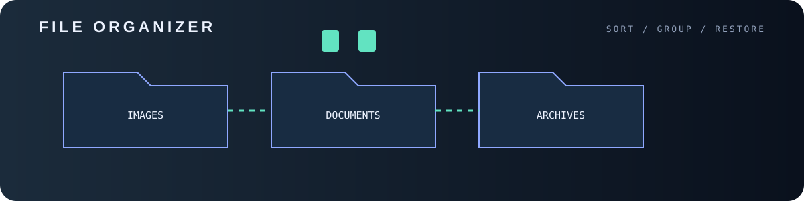

<div align="center">

<p align="center"></p>


# ️ file-organizer-py

**مرتب‌ساز فایل‌ها — فقط یک فایل پایتون، بدون `pip install`**


</div>

---

##  قابلیت‌ها

-  مرتب‌سازی بر اساس **نوع فایل** (Images, Documents, Audio, Archives, Code, ...)
-  مرتب‌سازی بر اساس **تاریخ** (`سال/سال-ماه`)
-  حالت **پیش‌نمایش** (`--dry-run`) قبل از جابه‌جایی
- ️ قابلیت **Undo** برای برگرداندن همه‌چیز
- ️ جلوگیری از بازنویسی فایل‌های هم‌نام
-  فقط کتابخانه‌های استاندارد پایتون؛ نیازی به نصب چیزی نیست

##  اجرا

فقط پایتون ۳ لازم است:

```bash
git clone https://github.com/ERROR404DTIR/file-organizer-py.git
cd file-organizer-py

python organizer.py ~/Downloads            # مرتب‌سازی بر اساس نوع
python organizer.py ~/Downloads --dry-run  # فقط پیش‌نمایش
python organizer.py ~/Downloads --by date  # مرتب‌سازی بر اساس تاریخ
python organizer.py ~/Downloads --undo     # برگرداندن آخرین مرتب‌سازی
```

> اگر مسیر ندهید، پوشه‌ی فعلی مرتب می‌شود.

##  نمونه خروجی

```text
a.jpg  ->  Images/a.jpg
b.pdf  ->  Documents/b.pdf
c.mp3  ->  Audio/c.mp3
d.zip  ->  Archives/d.zip
e.py   ->  Code/e.py
f.xyz  ->  Others/f.xyz
```

## ️ شخصی‌سازی

دسته‌ها و پسوندها در دیکشنری `CATEGORIES` بالای فایل `organizer.py` هستند؛ هر پسوندی را که خواستید اضافه یا حذف کنید.

##  ایمنی

- فایل‌های مخفی (با `.` شروع می‌شوند) دست‌نخورده می‌مانند.
- هر اجرا یک لاگ `.organizer_log.json` می‌سازد که `--undo` از آن استفاده می‌کند.

##  لایسنس

MIT